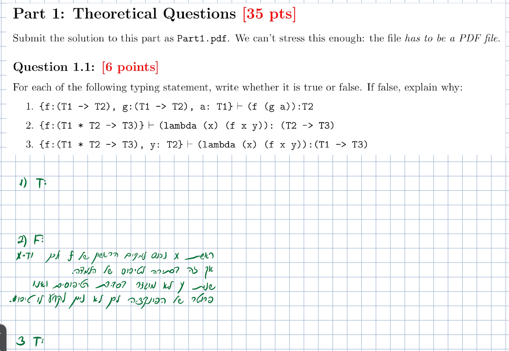
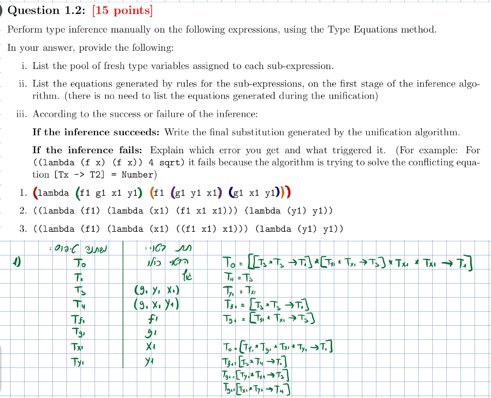
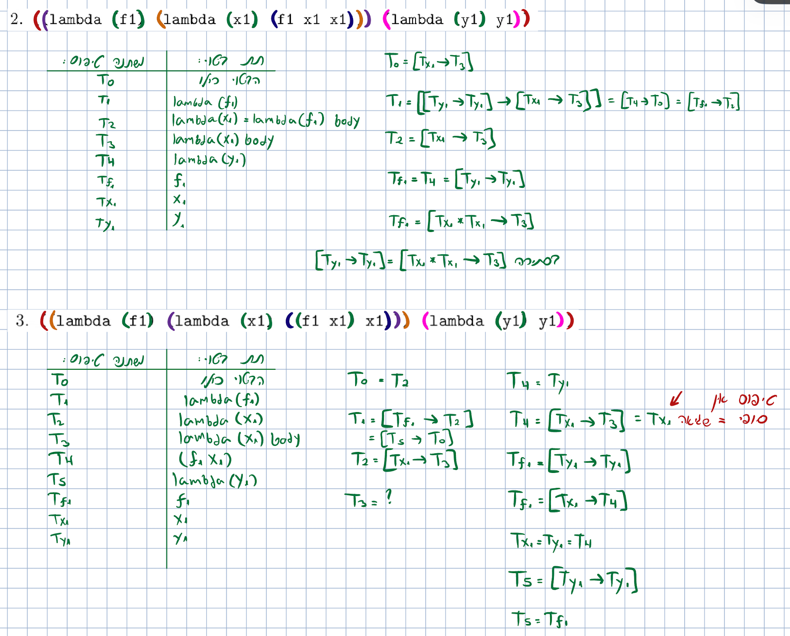
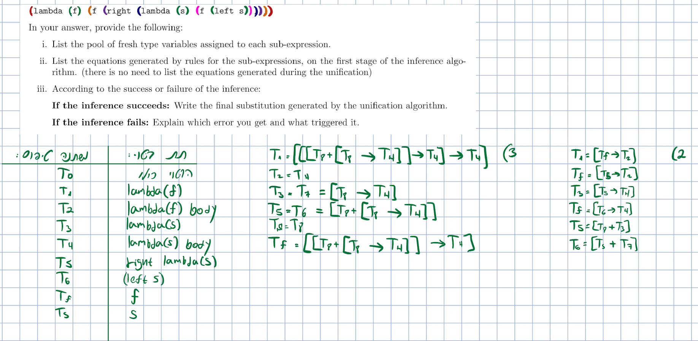

## Part 1: Theoretical Questions [35 pts]

Submit the solution to this part as `Part1.pdf`. We can't stress this enough: the file has to be a PDF file.

### [6 points] Question 1.1

For each of the following typing statement, write whether it is true or false. If false, explain why:

1. `{f:(T1 -> T2), g:(T1 -> T2), a: T1} ⊢ (f (g a)):T2`
2. `{f:(T1 * T2 -> T3)} ⊢ (lambda (x) (f x y)): (T2 -> T3)`
3. `{f:(T1 * T2 -> T3), y: T2} ⊢ (lambda (x) (f x y)):(T1 -> T3)`

**Answer (handwritten):** see also `Part1.pdf` / `images/HW3Q1.1.png`.



**Answer (typed):**

#### 1) T

#### 2) F

ראשית x נכנס במקום הראשון של f ולכן x = T1 אך זה בסתירה לטיפוס של הלמדה.

שנית y לא מוגדר בסביבת הטיפוסים ואינו פרמטר של הפונקציה לכן לא ניתן לקבוע לו טיפוס.

#### 3) T

### [15 points] Question 1.2

Perform type inference manually on the following expressions, using the Type Equations method.

In your answer, provide the following:

- i. List the pool of fresh type variables assigned to each sub-expression.
- ii. List the equations generated by rules for the sub-expressions, on the first stage of the inference algorithm. (there is no need to list the equations generated during the unification)
- iii. According to the success or failure of the inference:
  - **If the inference succeeds:** Write the final substitution generated by the unification algorithm.
  - **If the inference fails:** Explain which error you get and what triggered it. (For example: For `((lambda (f x) (f x)) 4 sqrt)` it fails because the algorithm is trying to solve the conflicting equation `[Tx -> T2] = Number`)

1. `(lambda (f1 g1 x1 y1) (f1 (g1 y1 x1) (g1 x1 y1)))`
2. `((lambda (f1) (lambda (x1) (f1 x1 x1))) (lambda (y1) y1))`
3. `((lambda (f1) (lambda (x1) ((f1 x1) x1))) (lambda (y1) y1))`

#### ביטוי 1

```scheme
(lambda (f1 g1 x1 y1) (f1 (g1 y1 x1) (g1 x1 y1)))
```

**Answer (handwritten):** see also `Part1.pdf` / `images/HW3Q1.2a.png`.



**Answer (typed):**

| משתנה טיפוס | תת ביטוי      |
| ----------- | ------------- |
| `T0`        | הביטוי כולו   |
| `T1`        | גוף           |
| `T3`        | `(g1 y1 x1)`  |
| `T4`        | `(g1 x1 y1)`  |
| `Tf1`       | `f1`          |
| `Tg1`       | `g1`          |
| `Tx1`       | `x1`          |
| `Ty1`       | `y1`          |

```
T0 = [[T3 * T3 -> T1] * [Tx1 * Tx1 -> T3] * Tx1 * Tx1 -> T1]
T4 = T3
Ty1 = Tx1
Tf1 = [T3 * T3 -> T1]
Tg1 = [Tx1 * Tx1 -> T3]
```

```
T0 = [Tf1 * Tg1 * Tx1 * Ty1 -> T1]
Tf1 = [T3 * T4 -> T1]
Tg1 = [Ty1 * Tx1 -> T3]
Tg1 = [Tx1 * Ty1 -> T4]
```

#### ביטוי 2

```scheme
((lambda (f1) (lambda (x1) (f1 x1 x1))) (lambda (y1) y1))
```

**Answer (handwritten):** see also `Part1.pdf` / `images/HW3Q1.2b.png`.



**Answer (typed):**

| משתנה טיפוס | תת ביטוי                       |
| ----------- | ------------------------------ |
| `T0`        | הביטוי כולו                    |
| `T1`        | `lambda (f1)`                  |
| `T2`        | `lambda(x1) = lambda(f1) body` |
| `T3`        | `lambda(x1) body`              |
| `T4`        | `lambda (y1)`                  |
| `Tf1`       | `f1`                           |
| `Tx1`       | `x1`                           |
| `Ty1`       | `y1`                           |

```
T0 = [Tx1 -> T3]
T1 = [[Ty1 -> Ty1] -> [Tx1 -> T3]] = [T4 -> T0] = [Tf1 -> T2]
T2 = [Tx1 -> T3]
Tf1 = T4 = [Ty1 -> Ty1]
Tf1 = [Tx1 * Tx1 -> T3]
```

סתירה:

```
[Ty1 -> Ty1] = [Tx1 * Tx1 -> T3]
```

#### ביטוי 3

```scheme
((lambda (f1) (lambda (x1) ((f1 x1) x1))) (lambda (y1) y1))
```

**Answer (handwritten):** in the image above, see also `Part1.pdf` / `images/HW3Q1.2b.png`.

**Answer (typed):**

| משתנה טיפוס | תת ביטוי           |
| ----------- | ------------------ |
| `T0`        | הביטוי כולו        |
| `T1`        | `lambda (f1)`      |
| `T2`        | `lambda (x1)`      |
| `T3`        | `lambda (x1) body` |
| `T4`        | `(f1 x1)`          |
| `T5`        | `lambda (y1)`      |
| `Tf1`       | `f1`               |
| `Tx1`       | `x1`               |
| `Ty1`       | `y1`               |

```
T0 = T2
T1 = [Tf1 -> T2] = [T5 -> T0]
T2 = [Tx1 -> T3]
T4 = Ty1
T4 = [Tx1 -> T3] = Tx1
Tf1 = [Ty1 -> Ty1]
Tf1 = [Tx1 -> T4]
Tx1 = Ty1 = T4
T5 = [Ty1 -> Ty1]
T5 = Tf1
```

טיפוס אין סופי = שגיאה:

```
T4 = [Tx1 -> T3] = Tx1
```

### [14 points] Question 1.3: Sum Types

In TypeScript, we learned how to combine union types and string literals to a pattern called tagged union, allowing you to discriminately pack expressions of different types under the same type. In this question, we consider the introduction of a simplified version of it to Scheme, called sum types.

Given two types `TE1` and `TE2`, the sum type of `TE1` and `TE2`, denoted as `(TE1 + TE2)`, has the following values:

```
(left E)  : (TE1 + TE2)   where E : TE1
(right E) : (TE1 + TE2)   where E : TE2
```

Where `left` and `right` are added to the set of keywords of the language, and `(left E)` and `(right E)` are added to the syntax as special forms.

So, for example, both `(left 2)` and `(right #t)` are values of type `(number + boolean)`.

Semantically, the value of `(left E)` is `(left V)`, and the value of `(right E)` is `(right V)`, where `V` is the value of `E`. So, for example, the value of `(left (+ 3 4))` is `(left 7)`, and the value of `(right (and #t #f))` is `(right #f)`. (Intuitively, you can think of `(left 7)` as a symbol `'(left . 7)`, and `(right #f)` as a symbol `'(right . #f)`)

Following this logic, we get the following type constraints for the `left` and `right` special forms:

- i. For the pool:

  ```
  T0   (left E)
  T1   E
  ```

  we get the equation:

  ```
  T0 = T1 + T
  ```

  where `T` is a fresh type variable.

  That's the equational way of saying: "Whenever `E` is a term of type `T1`, `(left E)` is a term of type `T1 + T`, for some arbitrary type `T`".

- ii. For the pool:

  ```
  T0   (right E)
  T1   E
  ```

  we get the equation:

  ```
  T0 = T + T1
  ```

  where `T` is a fresh type variable.

  That's the equational way of saying: "Whenever `E` is a term of type `T1`, `(right E)` is a term of type `T + T1`, for some arbitrary type `T`".

Using the type constraints specified above, perform type inference manually on the following expression:

```scheme
(lambda (f) (f (right (lambda (s) (f (left s))))))
```

In your answer, provide the following:

- i. List the pool of fresh type variables assigned to each sub-expression.
- ii. List the equations generated by rules for the sub-expressions, on the first stage of the inference algorithm. (there is no need to list the equations generated during the unification)
- iii. According to the success or failure of the inference:
  - **If the inference succeeds:** Write the final substitution generated by the unification algorithm.
  - **If the inference fails:** Explain which error you get and what triggered it.

**Answer (handwritten):** see also `Part1.pdf` / `images/HW3Q1.3.png`.



**Answer (typed):**

| משתנה טיפוס | תת ביטוי          |
| ----------- | ----------------- |
| `T0`        | הביטוי כולו       |
| `T1`        | `lambda(f)`       |
| `T2`        | `lambda(f) body`  |
| `T3`        | `lambda(s)`       |
| `T4`        | `lambda(s) body`  |
| `T5`        | `right lambda(s)` |
| `T6`        | `(left s)`        |
| `Tf`        | `f`               |
| `Ts`        | `s`               |

#### 2)

```
T1 = [Tf -> T2]
Tf = [T5 -> T2]
T3 = [Ts -> T4]
Tf = [T6 -> T4]
T5 = [T8 + T3]
T6 = [Ts + T7]
```

#### 3)

```
T1 = [[[T8 + [T8 -> T4]] -> T4] -> T4]
T2 = T4
T3 = T7 = [T8 -> T4]
T5 = T6 = [T8 + [T8 -> T4]]
Ts = T8
Tf = [[T8 + [T8 -> T4]] -> T4]
```
